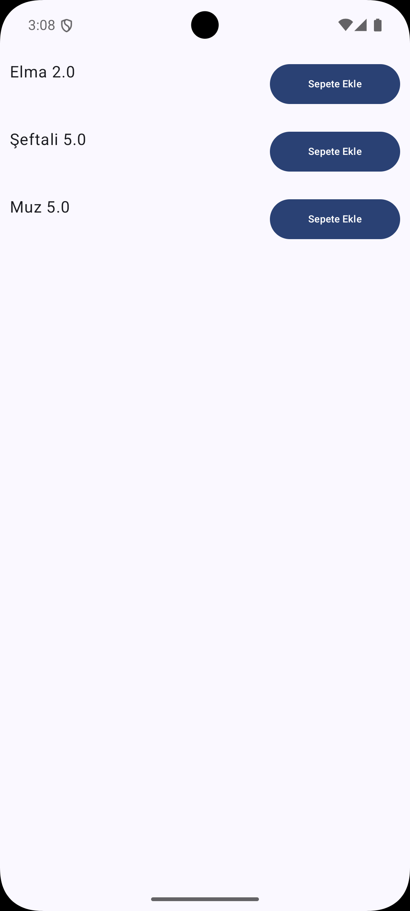
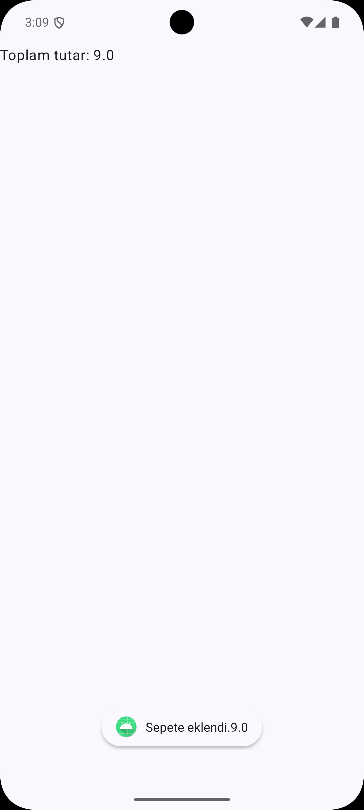

# 🛒 Alışveriş Listesi

Jetpack Compose ile yapılmış basit bir alışveriş listesi uygulaması.
Amaç: Compose temellerini tekrar etmek ve hatırlamak.

## Amaç
Compose'daki temel konuları pratik etmek için yaptım. Ticari bir hedefi yok.


## Bu projede pratik ettiklerim
| Konu | Nerede kullandım |
|------|------------------|
| `@Composable` fonksiyonlar | [Tüm ui sınıflarında] |
| `rememberCoroutineScope` | [ProductListScreen] |
| State hoisting | [ProductListScreen] |
| `Modifier` (padding, fillMaxWidth...) | Her yerde |
| ViewModel | [ProductListViewModel] |

## Ekran görüntüleri
<p align="center">
 
  
</p>

## Proje yapısı
```
app/src/main/java/com/ornek/alisveris/
├── MainActivity.kt     # Başlangıç noktası
├── NavigationPage.kt     # Navigation route
├── ui/                  # Composable'lar
├── data/               # Veri sınıfları
└── ui/theme/            # Renk, tipografi
```

## Notlarım (Hatırlatıcı)
- `remember` ekran döndürülünce sıfırlanır, kalıcı olması için `rememberSaveable` kullan.
- Listede `LazyColumn` içinde `key` vermeyi unutma, yoksa silme/ekleme sırasında state kayabilir.
- State'i alt composable'a verme, yukarıda tut (state hoisting): sebebi ise kolay test edilebilirlik ve tekrar kullanılabilmesi kolaylaşıyor., 
- `launchEffect` sadece ilk giriş ve key değişimi için uygundur. Key değeri primitive değer verilmeli, referans değerli değişken verince, state de adres değerleri değişmediğinden key güncellenmez.
- `Object` yerine `dataObject` kullan, debugging esnasında anlamlı ifadeler döndürür.
